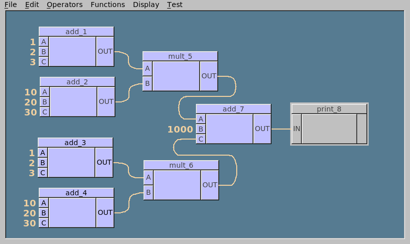
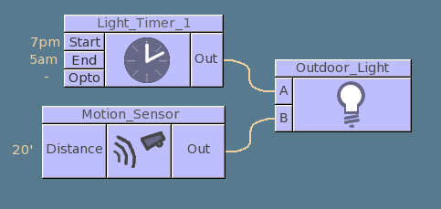
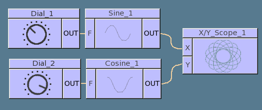

# Fl_OpDesk



**Connect boxes. Build visual programs. Bring modular systems to life.**

Fl_OpDesk is a C++ node graph widget for FLTK 1.x. Give users a workspace of movable operation boxes, wire their inputs and outputs together, and define what those connections mean in your application.

Use it to build visual programming tools, modular audio interfaces, simulation editors, or control-system layouts. Fl_OpDesk provides the interactive graph; your application supplies the behavior.

## Features

- **Interactive connections** between input and output ports on operation boxes.
- **Customizable wiring** with straight, solder-trace, and curved connection styles, plus adjustable colors and line widths.
- **Application-defined connection rules** through callbacks and virtual methods, with hooks for reporting invalid connections.
- **Extensible FLTK widgets** for defining your own boxes, ports, dialogs, and appearance.
- **A working example application** demonstrating data types, constants, copy/paste, saving and loading layouts, and Perl code generation.

## Try the demo

The project requires FLTK 1.x, a C++ compiler and standard library, and Make for Unix builds. The original project was tested on Linux, macOS, and Windows with FLTK 1.3.x.

### Linux and macOS

From the project directory, with `fltk-config` available on your `PATH`:

```sh
make FLTKCONFIG=fltk-config
./test-app/test-app
```

The build creates two programs:

| Program | Purpose |
| --- | --- |
| `test-OpDesk` | A basic widget example with a large grid of boxes. |
| `test-app/test-app` | A visual programming demo that generates Perl scripts and saves and loads graph layouts. |

Build settings live in `makeinclude`. Its current `FLTKCONFIG` setting points to a local FLTK installation; override it as above, supply the full path to your own `fltk-config`, or edit that setting for your system. Perl is needed to execute the demo's generated scripts.

### Windows

The project includes `make.bat` and `Makefile.MICROSOFT` for the Microsoft Visual Studio 8.x toolchain. Review the paths and compiler settings in `Makefile.MICROSOFT`, then run `make.bat` from a configured compiler command prompt.

## Build your own editor

Fl_OpDesk is organized around four small building blocks:

| Class | Role |
| --- | --- |
| [`Fl_OpDesk`](Fl_OpDesk.H) | The workspace that manages boxes and their connections. |
| [`Fl_OpBox`](Fl_OpBox.H) | An operation box with inputs on the left and outputs on the right. |
| [`Fl_OpButton`](Fl_OpButton.H) | An input or output port, with hooks for connection validation. |
| [`Fl_OpConnect`](Fl_OpConnect.H) | A connection between two ports, including its drawing attributes. |

Derive your own box and button classes to represent operations and data types. Use connection hooks to enforce compatibility, and extend the desk to handle application-specific behavior such as persistence, simulation, or code generation. Override widget drawing methods to customize the look.

Start with [`test-OpDesk.C`](test-OpDesk.C) for basic widget construction. For a fuller application, explore [`test-app/`](test-app/): `MyButton` handles data types, constants, and port dialogs; `MyBox` handles box naming and source generation; and `MyDesk` handles layout persistence, copy/paste, and connection errors. See the [demo README](test-app/README.txt) for a guide to its source files.

## Ideas to build on

The documentation illustrates how the same node graph interface can represent different modular systems. These are application concepts; the included working demo focuses on Perl code generation.

### Lighting and automation

Represent switches, sensors, and controlled devices as boxes, then connect them to describe a lighting or automation system.



### Signals and simulation

Connect sine and cosine generators to an oscilloscope's X and Y inputs. Changing frequencies can turn a circle into more intricate patterns—a natural starting point for an educational signal simulator.



## Documentation

API documentation is embedded in the source and can be generated with Doxygen:

```sh
make docs
```

Open `documentation/html/index.html` in a browser after generation. The [main API overview](Fl_OpDesk.H) explains the design and extension points; [CHANGES.txt](CHANGES.txt) records release history.

## License

Fl_OpDesk is distributed under the GNU Library General Public License with FLTK-style exceptions for subclassing and static linking. See [COPYING.txt](COPYING.txt) for the complete terms.

## Author and acknowledgements

Created by **Greg Ercolano**. Bug reports can be sent to **erco at seriss dot com**.

Thanks to **Al Ibrahim** for funding completion of the widget, and to **Reid Baker** for his blessing to preserve the look of Cinema Graphics' *ShadeTree*, co-designed in 1995 by Reid Baker, Greg Ercolano, Rodney Iwashina, and Liza Keith. Fl_OpDesk is a complete rewrite from the ground up, with no code from the original Motif/OpenGL implementation.
